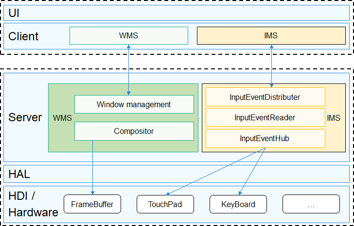

# WMS<a name="EN-US_TOPIC_0000001122925147"></a>

-   [Introduction](#section11660541593)
-   [Directory Structure](#section161941989596)
-   [Compilation and Building](#section137768191623)
-   [Description](#section1312121216216)
    -   [Usage](#section129654513264)

-   [Repositories Involved](#section1371113476307)

## Introduction<a name="section11660541593"></a>

The graphics service uses the client/server \(C/S\) architecture and is divided into two sub-services: Window Manager Service \(WMS\) and Input Manager Service \(IMS\). The application calls the APIs provided by the client to obtain the window status and process events. The server interacts with the hardware to implement display and input event distribution.

-   WMS: Manages and combines windows of different applications in a unified manner. Each window is bound to a  **RootView**  object.
-   IMS: Connects to the underlying input event driver framework to monitor and distribute input events.

-   Input device hot-plug: the IMS listens to the device online/offline events reported by the input driver, re-opens the device and registers its report callback when the device comes online, and cleans up the device when it goes offline; the status is also forwarded to the WMS, which disables the mouse pointer so that a frozen pointer does not stay on the screen. For the safe-remove case, the `RemoveDisconnectedInputDevice` API of the input driver is used when the `DRIVERS_PERIPHERAL_INPUT_FEATURE_HOTPLUG_SAFE_REMOVE` switch is enabled; both the API and the switch have to be provided by the driver repository.
-   Hardware back-buffer copy: when `ENABLE_GFX_ENGINES` is enabled, the back buffer is updated by the hardware graphics engine first, and falls back to a software copy when a buffer has no physical address, when the window size does not match the surface size, or when the hardware copy fails.
-   Input event handling optimization: events are dequeued in a batch and the lock is released before distribution, which shortens the critical path; the device opening flow validates its arguments and interface pointers, and a single device failure no longer aborts the initialization of the remaining devices.

**Figure  1** <a name="fig163546295165"></a>  




## Directory Structure<a name="section161941989596"></a>

```
/foundation/window/window_manager_lite
├── frameworks      # Client
│   ├── ims         # Input event management service client
│   └── wms         # Window management service client
├── interfaces      # APIs
│   ├── innerkits   # APIs between modules
├── services        # Server
│   ├── ims         # Input event management service
│   └── wms         # Window management service
└── test            # Test code
```

## Compilation and Building<a name="section137768191623"></a>

```
# Generate the wms_server and libwms_client.so files in the out directory of the product folder through GN compilation.
hb build window_manager_lite
```

## Description<a name="section1312121216216"></a>

### Usage<a name="section129654513264"></a>

-   WMS provides methods to display various UI components, send event notifications, and process various events. For details, see the related source code.
-   **test/sample\_window**  provides the unit testing for each WMS API. Refer to it for the usage of WMS.

## Repositories Involved<a name="section1371113476307"></a>

[Graphic subsystem](https://gitee.com/openharmony/docs/blob/master/en/readme/graphics.md)

**window_manager_lite**

[graphic_surface_lite](https://gitee.com/openharmony/graphic_surface_lite/blob/master/README.md)

[arkui_ui_lite](https://gitee.com/openharmony/arkui_ui_lite/blob/master/README.md)

[graphic_graphic_utils_lite](https://gitee.com/openharmony/graphic_graphic_utils_lite/blob/master/README.md)
