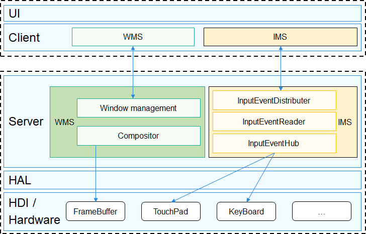

# 图形WMS组件<a name="ZH-CN_TOPIC_0000001122925147"></a>

-   [简介](#section11660541593)
-   [目录](#section161941989596)
-   [编译构建](#section137768191623)
-   [说明](#section1312121216216)
    -   [使用说明](#section129654513264)

-   [相关仓](#section1371113476307)
-   [本次改动](#section_changes_zh)

## 简介<a name="section11660541593"></a>

图形服务采用C/S架构，内部分为窗口管理（WMS: Window Manager Service）和输入事件管理（IMS: Input Manager Service）两个子服务。APP调用客户端接口完成窗口状态获取、事件处理等操作，服务端与硬件交互实现送显、输入事件分发等。

-   WMS：窗口管理服务对不同APP的窗口进行统一管理、合成。窗口与UI组件中的RootView呈一一对应的关系；
-   IMS：输入事件管理服务对接底层输入事件驱动框架，对输入事件进行监听和分发。

**图 1** <a name="fig163546295165"></a>  




## 目录<a name="section161941989596"></a>

```
/foundation/window/window_manager_lite
├── frameworks      # 客户端
│   ├── ims         # 输入管理客户端
│   └── wms         # 窗口管理服务客户端
├── interfaces      # 接口
│   └── innerkits   # 模块间接口
├── services        # 服务端
│   ├── ims         # 输入管理服务
│   └── wms         # 窗口管理服务
└── test            # 测试代码
```

## 编译构建<a name="section137768191623"></a>

```
# 通过gn编译,在out目录下对应产品的文件夹中生成可执行文件wms_server和libwms_client.so
hb build window_manager_lite
```

## 说明<a name="section1312121216216"></a>

### 使用说明<a name="section129654513264"></a>

-   图形UI组件基于WMS组件实现了各种UI组件的显示以及事件通知、处理，可参考相关源码；
-   test/sample\_window提供了WMS组件各接口的单元测试，也可参考使用。

## 相关仓<a name="section1371113476307"></a>

[图形子系统](https://gitee.com/openharmony/docs/blob/master/zh-cn/readme/%E5%9B%BE%E5%BD%A2%E5%AD%90%E7%B3%BB%E7%BB%9F.md)

**window_manager_lite**

[graphic_surface_lite](https://gitee.com/openharmony/graphic_surface_lite/blob/master/README.md)

[arkui_ui_lite](https://gitee.com/openharmony/arkui_ui_lite/blob/master/README.md)

[graphic_graphic_utils_lite](https://gitee.com/openharmony/graphic_graphic_utils_lite/blob/master/README.md)

# 本次改动<a name="section_changes_zh"></a>

本仓针对 HiSpark AiFly（Hi3403V100）开发板进行功能适配。为便于区分，以下按“新增能力”与“原有功能增强”两部分说明。

## 新增能力

1. 新增输入设备热插拔支持
    -   在 `services/ims/input_event_hub.h`、`services/ims/input_event_hub.cpp` 中新增 `HotPlugCallback` 回调与 `hotPlugCallback_` 成员：设备上线时自动重新打开并注册上报回调，设备下线时清理对应设备位；下线处理可配合输入驱动的安全移除接口（`RemoveDisconnectedInputDevice`，由 `DRIVERS_PERIPHERAL_INPUT_FEATURE_HOTPLUG_SAFE_REMOVE` 宏控制）。
    -   `SetUp` 中新增注册热插拔回调（先扫描并打开设备、最后注册回调），`TearDown` 中新增注销热插拔回调。
    -   设备上下线状态经 `InputEventHub::RegisterDeviceStatusCallback` → `InputEventDistributer::DistributeDeviceStatus` 通知上层（如 WMS 在鼠标下线时关闭光标）。

2. 新增窗口后缓冲硬件搬运能力
    -   在 `services/wms/lite_win.h`、`services/wms/lite_win.cpp` 中新增 `TryHardwareBlit`：当使能 `ENABLE_GFX_ENGINES` 且收发缓冲均具备物理地址时，优先使用硬件图形引擎完成后备缓冲更新，失败回退软件拷贝。
    -   新增 `DoSoftwareCopy` 承接原有软件拷贝逻辑（按 `ARM_NEON_OPT` 选择 NEON 拷贝或 `memcpy_s`）。

3. 新增输入驱动热插拔特性开关接入
    -   在 `BUILD.gn` 中引入 `//drivers/peripheral/input/input.gni`，并将 `drivers_peripheral_input_feature_hotplug_safe_remove` 特性开关映射为 `DRIVERS_PERIPHERAL_INPUT_FEATURE_HOTPLUG_SAFE_REMOVE` 宏。

## 原有功能增强

1. 原有输入设备打开流程增强
    -   原有功能：`InputEventHub::SetUp` 内联打开设备并注册回调，单个设备失败即中断后续设备初始化。
    -   本次增强：拆分出 `OpenDevice`，增加入参合法性、接口指针判空校验；注册回调失败时回关设备；单设备失败仅记录日志，不中断其余设备。

2. 原有输入事件分发逻辑增强
    -   原有功能：`InputManagerService::Distribute` 在持锁状态下执行事件分发。
    -   本次增强：调整为先出队并解锁、再分发，缩短临界区，降低分发耗时对入队的影响。

3. 原有后备缓冲更新流程增强
    -   原有功能：`LiteWindow::UpdateBackBuf` 深层嵌套，异常路径处理分散。
    -   本次增强：改为提前返回的扁平结构，统一在结尾释放缓冲，并接入硬件搬运优先、软件拷贝兜底的两级路径。

4. 原有鼠标光标显示逻辑增强
    -   原有功能：`LiteWM::OnRawEvent` 使用 `firstTime` 静态标记，仅当第一帧鼠标事件到来时开启光标，其后非鼠标事件不会关闭光标。
    -   本次增强：改为按事件类型实时判定——在收到第一个鼠标事件时开启光标并置 `needRedraw`，其后由 `UpdateMouseCursor` 按位置变化触发重绘，非鼠标事件不再误开光标；同时补齐光标关闭路径，鼠标设备下线时经设备状态通知关闭光标并重绘光标所在区域（见「新增能力 1」的设备状态通知）。

5. 原有硬件合成条件判断增强
    -   原有功能：`LiteWindow::Flush` 使用 `#if ENABLE_GFX_ENGINES` 判断，未定义宏时按 0 处理。
    -   本次增强：改为 `#if defined(ENABLE_GFX_ENGINES) && ENABLE_GFX_ENGINES`，消除未定义告警并使判断语义更严谨。

6. 原有组件描述文件增强
    -   原有功能：`bundle.json` 中使用拼写错误的 `feature` 字段。
    -   本次增强：修正为标准的 `features` 字段。
