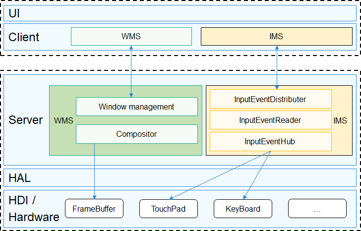

# 图形WMS组件<a name="ZH-CN_TOPIC_0000001122925147"></a>

-   [简介](#section11660541593)
-   [目录](#section161941989596)
-   [编译构建](#section137768191623)
-   [说明](#section1312121216216)
    -   [使用说明](#section129654513264)

-   [相关仓](#section1371113476307)

## 简介<a name="section11660541593"></a>

图形服务采用C/S架构，内部分为窗口管理（WMS: Window Manager Service）和输入事件管理（IMS: Input Manager Service）两个子服务。APP调用客户端接口完成窗口状态获取、事件处理等操作，服务端与硬件交互实现送显、输入事件分发等。

-   WMS：窗口管理服务对不同APP的窗口进行统一管理、合成。窗口与UI组件中的RootView呈一一对应的关系；
-   IMS：输入事件管理服务对接底层输入事件驱动框架，对输入事件进行监听和分发。

此外，本组件针对 HiSpark AiFly（Hi3403V100）开发板补充了以下能力：

-   输入设备热插拔：IMS 监听输入驱动上报的设备上下线事件，设备上线时自动重新打开并注册数据上报回调，下线时清理对应设备并通知 WMS；WMS 据此在鼠标下线时关闭光标，避免光标残留在屏幕上。设备安全移除场景可配合输入驱动的 `RemoveDisconnectedInputDevice` 接口，该接口与 `DRIVERS_PERIPHERAL_INPUT_FEATURE_HOTPLUG_SAFE_REMOVE` 开关需由驱动仓配套提供。
-   后备缓冲硬件搬运：`ENABLE_GFX_ENGINES` 使能时，窗口后备缓冲更新优先交由硬件图形引擎搬运；缓冲缺少物理地址、窗口尺寸与 surface 尺寸不一致或搬运失败时，自动回退到软件拷贝。
-   输入事件处理优化：事件分发改为批量出队并释放锁后再分发，缩短临界区；设备打开流程增加入参与接口指针校验，单个设备打开失败不再中断其余设备的初始化。

**图 1** <a name="fig163546295165"></a>  




## 目录<a name="section161941989596"></a>

```
/foundation/window/window_manager_lite
├── frameworks      # 客户端
│   ├── ims         # 输入管理客户端
│   └── wms         # 窗口管理服务客户端
├── interfaces      # 接口
│   └── innerkits   # 模块间接口
├── services        # 服务端
│   ├── ims         # 输入管理服务
│   └── wms         # 窗口管理服务
└── test            # 测试代码
```

## 编译构建<a name="section137768191623"></a>

```
# 通过gn编译,在out目录下对应产品的文件夹中生成可执行文件wms_server和libwms_client.so
hb build window_manager_lite
```

## 说明<a name="section1312121216216"></a>

### 使用说明<a name="section129654513264"></a>

-   图形UI组件基于WMS组件实现了各种UI组件的显示以及事件通知、处理，可参考相关源码；
-   test/sample\_window提供了WMS组件各接口的单元测试，也可参考使用。

## 相关仓<a name="section1371113476307"></a>

[图形子系统](https://gitee.com/openharmony/docs/blob/master/zh-cn/readme/%E5%9B%BE%E5%BD%A2%E5%AD%90%E7%B3%BB%E7%BB%9F.md)

**window_manager_lite**

[graphic_surface_lite](https://gitee.com/openharmony/graphic_surface_lite/blob/master/README.md)

[arkui_ui_lite](https://gitee.com/openharmony/arkui_ui_lite/blob/master/README.md)

[graphic_graphic_utils_lite](https://gitee.com/openharmony/graphic_graphic_utils_lite/blob/master/README.md)
